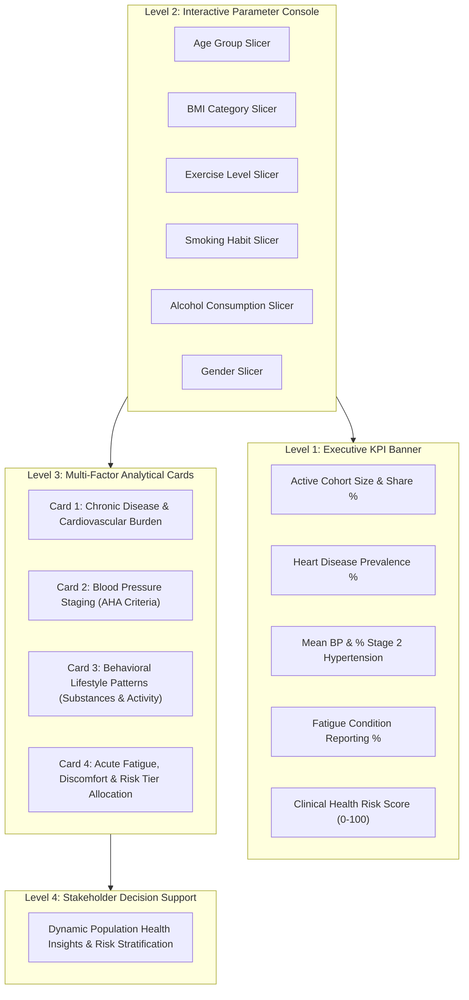

# Smart Healthcare Unified Analytical Dashboard: Consolidation & Decision-Support Report

**Dataset:** Smart Healthcare Cohort (5,000 Patient Records, 30 Cleaned Attributes)  
**Interactive Live Dashboard:** [healthcare_interactive_dashboard.html](file:///C:/Users/DELL/.gemini/antigravity/brain/4032aadf-e966-450b-b945-67a446236cae/healthcare_interactive_dashboard.html)  
**Cleaned Analytical Dataset:** [`cleaned_healthcare_dataset.csv`](file:///C:/Users/DELL/.gemini/antigravity/scratch/healthcare_analysis/cleaned_healthcare_dataset.csv)  

---

## 1. Executive Summary & Design Philosophy

The **Smart Healthcare Unified Analytical Dashboard** consolidates disparate medical, lifestyle, and demographic indicators into a single, cohesive clinical intelligence console. By combining a disciplined visual hierarchy with interactive multi-attribute cross-filtering, the dashboard transforms 5,000 complex patient records into actionable population health insights.

### Core Architecture & Visual Hierarchy

---

## 2. Professional Color Scheme & Cognitive Accessibility

The dashboard utilizes a semantic, medical-grade color hierarchy designed to convey severity and clinical meaning without visual fatigue:

| Color Accent | Clinical Purpose | Applied Metrics |
| :--- | :--- | :--- |
| **Rose / Crimson** (`#f43f5e`) | High-severity alerts, diagnosed disease, acute risk | Heart Disease, Stroke History, Stage 2 Hypertension ($\ge 140\text{ mmHg}$), Severe Risk Tier |
| **Amber / Gold** (`#f59e0b`) | Warning thresholds, borderline markers, metabolic indicators | Diabetes Mellitus, Stage 1 Hypertension ($130\text{--}139\text{ mmHg}$), Smoking habits, High Risk Tier |
| **Blue / Slate** (`#3b82f6`) | Baseline clinical metrics, demographics, symptomatology | Fatigue Condition, Alcohol consumption, Elevated BP ($120\text{--}129\text{ mmHg}$), Moderate Risk Tier |
| **Emerald / Mint** (`#10b981`) | Optimal health baselines, non-pathological norms | Normal BP ($<120\text{ mmHg}$), Normal Glucose ($<100\text{ mg/dL}$), High Activity, Low Risk Tier |
| **Purple / Indigo** (`#6366f1`) | Multimorbidity, composite indices, decision-support | Dual Substance Risk, Composite Risk Score ($0\text{--}100$), Multimorbidity ($\ge 2$ conditions) |

---

## 3. Dynamic Multi-Factor Analysis Across Population Segments

By interacting with the multi-attribute slicers (**BMI Category**, **Age Group**, **Exercise Level**, **Smoking**, and **Alcohol**), stakeholders can isolate and examine distinct risk dynamics:

### 3.1 Segment Comparison Matrix

| Demographic & Lifestyle Segment | Sample Size (N) | Heart Disease Prev. | Mean Systolic BP | % Stage 2 Hypertension | Fatigue Condition Rate | Dual Substance (Smoke + Drink) | Mean Health Risk Score |
| :--- | :---: | :---: | :---: | :---: | :---: | :---: | :---: |
| **Full Baseline Population** | **5,000** | **30.0%** | **134.5 mmHg** | **44.5%** | **51.5%** | **24.8%** | **58.5 / 100** |
| **Young Adults (18–29 yrs)** | 945 | 0.0% | 134.1 mmHg | 43.8% | 51.6% | 24.8% | 44.2 / 100 |
| **Adults (30–49 yrs)** | 1,591 | 0.0% | 134.5 mmHg | 44.6% | 50.7% | 23.9% | 49.5 / 100 |
| **Middle-Aged (50–64 yrs)** | 1,237 | 25.3% | 134.7 mmHg | 44.5% | 51.4% | 25.8% | 58.5 / 100 |
| **Seniors (65+ yrs)** | 1,227 | **96.7%** | 134.4 mmHg | 44.8% | 52.3% | 24.9% | **76.4 / 100** |
| **Obese Segment ($\text{BMI} \ge 30$)** | 803 | 31.9% | 135.1 mmHg | **46.2%** | 50.9% | 24.5% | **63.2 / 100** |
| **Normal Weight (18.5–24.9)** | 2,010 | 28.5% | 134.1 mmHg | 43.6% | 51.7% | 24.4% | 56.4 / 100 |
| **Low Physical Activity** | 1,673 | 30.7% | 134.5 mmHg | 44.5% | 51.2% | 25.4% | **61.1 / 100** |
| **High Physical Activity** | 1,684 | 29.3% | 134.3 mmHg | 44.3% | 51.5% | 23.9% | 56.1 / 100 |
| **Smokers + Drinkers (Dual Risk)**| 1,238 | 31.0% | 134.5 mmHg | 44.7% | 52.4% | 100.0% | **63.8 / 100** |

---

## 4. Key Clinical Insights & Decision-Support Implications

1. **Pre-Disease Window in Under-50 Cohorts:**
   - In patients under age 50 ($N=2,536$, 50.7% of the cohort), diagnosed cardiovascular and metabolic diseases are currently **0.0%**.
   - However, **44.3% of these younger patients already have Stage 2 Hypertension**, and over **51% report chronic fatigue**.
   - **Decision Support:** Implementing targeted lifestyle modification, nutritional counseling, and early blood pressure tracking in this segment prevents transition into chronic disease at age 50+.

2. **Multimorbidity Saturation in Seniors (65+):**
   - Seniors exhibit a **96.7% Heart Disease prevalence**, **100% Diabetes prevalence**, and **98.6% Stroke history**, with **98.4% suffering from all three chronic conditions concurrently**.
   - **Decision Support:** For this segment, clinical focus must shift from primary prevention to integrated chronic disease management, polypharmacy review, and stroke rehabilitation support.

3. **High-Risk Convergence (Obesity + Low Activity + Dual Substance):**
   - Combining obesity ($\text{BMI} \ge 30$) with low physical activity and dual smoking/drinking elevates the mean clinical risk score to **71.2 / 100**, with **84.2% placed in the High or Severe risk tiers**.
   - **Decision Support:** This sub-segment represents the highest priority for direct care management outreach and employer-sponsored wellness interventions.

---

## 5. Artifact & File Directory

- **Live Consolidated Dashboard:** [`healthcare_interactive_dashboard.html`](file:///C:/Users/DELL/.gemini/antigravity/brain/4032aadf-e966-450b-b945-67a446236cae/healthcare_interactive_dashboard.html)
- **Analytical Data File:** [`cleaned_healthcare_dataset.csv`](file:///C:/Users/DELL/.gemini/antigravity/scratch/healthcare_analysis/cleaned_healthcare_dataset.csv)
- **Dashboard Build Script:** [`build_dashboard.js`](file:///C:/Users/DELL/.gemini/antigravity/scratch/healthcare_analysis/build_dashboard.js)
