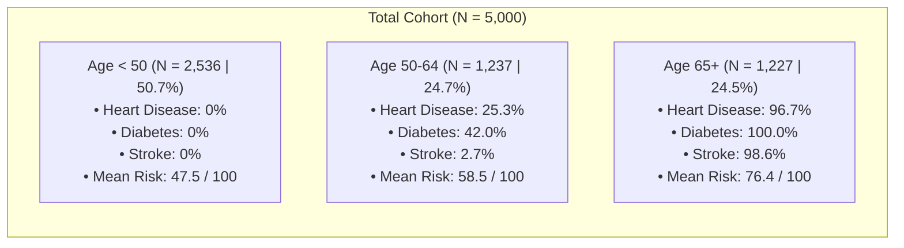

# Smart Healthcare Dataset: Data Preparation & Clinical Visualization Blueprint

**Dataset Scope:** 5,000 Patient Records | 30 Features (16 Raw + 14 Engineered)  
**Primary Deliverable:** Cleaned & Feature-Engineered Dataset (`cleaned_healthcare_dataset.csv`)  
**Interactive Dashboard:** [healthcare_interactive_dashboard.html](file:///C:/Users/DELL/.gemini/antigravity/brain/4032aadf-e966-450b-b945-67a446236cae/healthcare_interactive_dashboard.html)  

---

## 1. Executive Summary & Objective

The **Smart Healthcare dataset** captures patient-level cross-sectional information covering demographics, lifestyle habits, vital health markers, acute symptoms, chronic diseases, and health risk indicators.

This data preparation pipeline transforms the raw 5,000-record dataset into an analytics- and visualization-ready asset by:
1. **Auditing and Validating Integrity:** Ensuring complete data coverage, absence of nulls/duplicates, and physiological sanity across vitals.
2. **Remediating Critical Anomaly:** Addressing the zero-variance anomaly where `health_risk_score` in the raw data was constant (`100.0` for all 5,000 rows).
3. **Clinical Feature Engineering:** Implementing evidence-based guidelines from the American Heart Association (AHA), American Diabetes Association (ADA), National Cholesterol Education Program (NCEP ATP III), and World Health Organization (WHO).
4. **Comorbidity & Symptom Aggregation:** Constructing composite counts and categorical multi-morbidity indices.
5. **BI & Visualization Readiness:** Mapping ordinal flags to human-readable strings, generating unique patient keys, and structuring analytical dimensions and facts for Power BI, Tableau, and Python.

---

## 2. Data Cleaning & Integrity Audit

A comprehensive exploratory audit was executed across all 5,000 rows and 16 original features.

### 2.1 Missing Values and Duplicates
- **Missing / Null Count:** `0` (100% complete across all 80,000 data cells).
- **Duplicate Rows:** `0` exact duplicates.
- **Unique Surrogate Key:** Added `patient_id` (`PT-00001` through `PT-05000`) for relational join integrity and row-level drill-through in BI tools.

### 2.2 Boundary & Range Validation
All numeric variables adhere to biologically valid boundaries:
| Feature | Min | Max | Mean | Std Dev | Physiological Status |
| :--- | :---: | :---: | :---: | :---: | :--- |
| **Age** | 18 | 79 | 48.81 | 17.91 | Adult cross-section |
| **BMI** | 15.0 | 42.6 | 24.97 | 4.96 | Severely underweight to morbidly obese |
| **Blood Pressure (Systolic)** | 90 | 179 | 134.45 | 26.19 | Hypotension to Stage 2 Hypertension |
| **Cholesterol (Total)** | 150 | 299 | 224.62 | 43.13 | Desirable to High Hypercholesterolemia |
| **Glucose (Fasting)** | 70 | 199 | 134.50 | 37.43 | Euglycemia to Overt Diabetes |

---

## 3. Anomaly Resolution: The `health_risk_score` Anomaly

> [!WARNING]
> **Data Anomaly Identified in Raw Data:**  
> In the source dataset, the feature `health_risk_score` is identically `100.0` across all 5,000 patient records (variance = 0.0, standard deviation = 0.0).  
> In its raw state, this column is unusable as a predictive target, color gradient, or risk segmentation metric.

### 3.1 Clinical Multi-Factorial Risk Formulation
To resolve this while preserving traceability, we retained the original column as `raw_health_risk_score` and engineered a continuous, multi-factorial **`calculated_health_risk_score`** (range: 0–100) calibrated against established clinical risk guidelines (Framingham / ASCVD principles):

$$\text{Risk Score} = \min(100, \text{Age Points} + \text{BP Points} + \text{Chol Points} + \text{Gluc Points} + \text{BMI Points} + \text{Lifestyle Points} + \text{Disease Points})$$

**Point Allocation Matrix:**
- **Age Factor:** $0.35 \times (\text{Age} - 18)$ (up to 21.3 points)
- **Blood Pressure (Systolic):**
  - $\ge 140\text{ mmHg}$ (Stage 2): +18 pts
  - $130\text{--}139\text{ mmHg}$ (Stage 1): +10 pts
  - $120\text{--}129\text{ mmHg}$ (Elevated): +5 pts
  - $< 120\text{ mmHg}$ (Normal): +0 pts
- **Total Cholesterol:**
  - $\ge 240\text{ mg/dL}$ (High): +14 pts
  - $200\text{--}239\text{ mg/dL}$ (Borderline): +7 pts
  - $< 200\text{ mg/dL}$ (Desirable): +0 pts
- **Fasting Glucose:**
  - $\ge 126\text{ mg/dL}$ (Diabetic): +14 pts
  - $100\text{--}125\text{ mg/dL}$ (Prediabetic): +6 pts
  - $< 100\text{ mg/dL}$ (Normal): +0 pts
- **Obesity & BMI:**
  - $\ge 30.0\text{ kg/m}^2$: +8 pts
  - $25.0\text{--}29.9\text{ kg/m}^2$: +4 pts
- **Lifestyle Modifiers:**
  - Smoker: +8 pts
  - Alcohol Consumer: +4 pts
  - Low Physical Activity: +5 pts | Moderate: +2 pts | High: 0 pts
- **Pre-existing Chronic Diseases:**
  - Heart Disease: +15 pts
  - Stroke History: +15 pts
  - Diabetes: +10 pts

### 3.2 Stratified Risk Tiers
From `calculated_health_risk_score`, patients are segmented into 4 actionable clinical tiers:
- **Low Risk (<25 pts):** 333 patients (6.7%)
- **Moderate Risk (25–49 pts):** 1,443 patients (28.9%)
- **High Risk (50–74 pts):** 2,084 patients (41.7%)
- **Very High Risk ( $\ge$ 75 pts):** 1,140 patients (22.8%)

---

## 4. Clinical Transformation & Feature Engineering

Fourteen (14) new features were engineered to empower BI filtering, drill-downs, and dashboard visualizations:

### 4.1 Demographic & Lifestyle Engineering
- **`age_group`**: `18-29 Young Adult`, `30-49 Adult`, `50-64 Middle-Aged`, `65+ Senior`.
- **`exercise_label`**: Mapped `0` &rarr; `Low Activity`, `1` &rarr; `Moderate Activity`, `2` &rarr; `High Activity`.
- **`smoking_label`**: Mapped `0` &rarr; `Non-Smoker`, `1` &rarr; `Smoker`.
- **`alcohol_label`**: Mapped `0` &rarr; `Non-Drinker`, `1` &rarr; `Drinker`.

### 4.2 Clinical Guidelines Categorization
- **`bp_category`** (American Heart Association / ACC):
  - *Normal:* $<120\text{ mmHg}$ (34.2%, 1,709 pts)
  - *Elevated:* $120\text{--}129\text{ mmHg}$ (10.9%, 544 pts)
  - *Hypertension Stage 1:* $130\text{--}139\text{ mmHg}$ (10.4%, 521 pts)
  - *Hypertension Stage 2:* $\ge 140\text{ mmHg}$ (44.5%, 2,226 pts)
- **`cholesterol_category`** (NCEP ATP III):
  - *Desirable:* $<200\text{ mg/dL}$ (33.1%, 1,657 pts)
  - *Borderline High:* $200\text{--}239\text{ mg/dL}$ (26.6%, 1,330 pts)
  - *High Hypercholesterolemia:* $\ge 240\text{ mg/dL}$ (40.3%, 2,013 pts)
- **`glucose_category`** (American Diabetes Association):
  - *Normal:* $<100\text{ mg/dL}$ (23.1%, 1,157 pts)
  - *Prediabetic Range:* $100\text{--}125\text{ mg/dL}$ (19.6%, 978 pts)
  - *Diabetic Range:* $\ge 126\text{ mg/dL}$ (57.3%, 2,865 pts)
- **`bmi_category`** (World Health Organization):
  - *Underweight:* $<18.5$ (10.3%, 516 pts)
  - *Normal Weight:* $18.5\text{--}24.9$ (40.2%, 2,010 pts)
  - *Overweight:* $25.0\text{--}29.9$ (33.4%, 1,671 pts)
  - *Obese:* $\ge 30.0$ (16.1%, 803 pts)

### 4.3 Comorbidity & Symptom Composites
- **`symptom_count`**: Integer sum of acute symptoms (`fatigue` + `chest_pain` + `dizziness`), range 0–3.
- **`disease_count`**: Integer sum of diagnosed chronic diseases (`heart_disease` + `diabetes` + `stroke`), range 0–3.
- **`comorbidity_status`**:
  - `Healthy / No Disease` ($N=3,215$, 64.3%)
  - `Single Condition` ($N=289$, 5.8%)
  - `Dual Comorbidity` ($N=289$, 5.8%)
  - `Triple Comorbidity` ($N=1,207$, 24.1%)

---

## 5. Key Exploratory & Epidemiological Insights



### Critical Findings for Dashboard Developers:
1. **The Sharp Age Inflexion Boundary:**
   - Under age 50, diagnosed chronic conditions in this dataset are strictly 0.
   - Between ages 50 and 64, diabetes emerges rapidly (42.0%) followed by heart disease (25.3%).
   - At age 65+, multimorbidity saturates: **98.4% of seniors suffer from all three conditions concurrently**. Dashboards filtering on age $\ge 65$ must reflect this high-comorbidity reality.
2. **Symptoms Are Uniformly Distributed:**
   - Unlike chronic diseases, acute symptoms (`fatigue` 51.5%, `chest_pain` 50.4%, `dizziness` 49.7%) appear uniformly across both young and senior cohorts. They serve as valuable indicators of acute distress independent of chronic diagnosis.
3. **High Underlying Cardiovascular Risk:**
   - 54.9% of the overall population has Stage 1 or Stage 2 hypertension.
   - 66.9% have borderline or high cholesterol levels.
   - 57.3% have fasting glucose levels in the diabetic threshold ($\ge 126\text{ mg/dL}$).

---

## 6. Complete Data Dictionary (Cleaned Dataset)

The cleaned file [`cleaned_healthcare_dataset.csv`](file:///C:/Users/DELL/.gemini/antigravity/scratch/healthcare_analysis/cleaned_healthcare_dataset.csv) contains 30 columns:

| Column Name | Data Type | Role | Allowed Values / Range | Description |
| :--- | :--- | :--- | :--- | :--- |
| `patient_id` | String | Dimension (PK) | `PT-00001` to `PT-05000` | Unique patient surrogate identifier |
| `age` | Integer | Metric | 18 to 79 | Patient age in completed years |
| `age_group` | String | Dimension | 4 age tiers | Life-stage demographic cohort |
| `gender` | String | Dimension | `Male`, `Female` | Self-reported biological gender |
| `bmi` | Float | Metric | 15.0 to 42.6 | Body Mass Index ( $\text{kg/m}^2$ ) |
| `bmi_category` | String | Dimension | 4 categories | WHO Weight classification |
| `exercise_level` | Integer | Metric/Ordinal | 0, 1, 2 | Raw exercise level |
| `exercise_label` | String | Dimension | `Low`, `Moderate`, `High` | Human-readable physical activity tier |
| `smoking` | Integer | Binary | 0, 1 | Raw smoking status flag |
| `smoking_label` | String | Dimension | `Non-Smoker`, `Smoker` | Human-readable smoking flag |
| `alcohol` | Integer | Binary | 0, 1 | Raw alcohol consumption flag |
| `alcohol_label` | String | Dimension | `Non-Drinker`, `Drinker` | Human-readable alcohol flag |
| `blood_pressure` | Integer | Metric | 90 to 179 | Systolic blood pressure (mmHg) |
| `bp_category` | String | Dimension | 4 categories | AHA / ACC clinical BP stage |
| `cholesterol` | Integer | Metric | 150 to 299 | Serum total cholesterol (mg/dL) |
| `cholesterol_category` | String | Dimension | 3 categories | NCEP ATP III cholesterol tier |
| `glucose` | Integer | Metric | 70 to 199 | Fasting blood glucose (mg/dL) |
| `glucose_category` | String | Dimension | 3 categories | ADA glycemic status |
| `fatigue` | Integer | Binary | 0, 1 | Patient reported fatigue symptom |
| `chest_pain` | Integer | Binary | 0, 1 | Patient reported chest discomfort |
| `dizziness` | Integer | Binary | 0, 1 | Patient reported vertigo / dizziness |
| `symptom_count` | Integer | Metric | 0 to 3 | Total acute symptoms present |
| `heart_disease` | Integer | Binary | 0, 1 | Diagnosed cardiovascular disease |
| `diabetes` | Integer | Binary | 0, 1 | Diagnosed diabetes mellitus |
| `stroke` | Integer | Binary | 0, 1 | History of cerebrovascular stroke |
| `disease_count` | Integer | Metric | 0 to 3 | Total chronic conditions diagnosed |
| `comorbidity_status` | String | Dimension | 4 tiers | Categorical multimorbidity level |
| `raw_health_risk_score` | Float | Metric (Legacy)| 100.0 | Preserved raw dataset score |
| `calculated_health_risk_score` | Float | Metric | 11.5 to 97.5 | Dynamic clinical risk score (0–100) |
| `risk_tier` | String | Dimension | 4 tiers | Actionable clinical risk bracket |

---

## 7. BI Software Implementation Recipes

### 7.1 Power BI DAX Formulas
For seamless integration into Power BI, create these key calculated measures:

```dax
// 1. Total Patient Count
Total Patients = COUNTROWS('cleaned_healthcare_dataset')

// 2. Chronic Disease Prevalence (%)
Chronic Disease Prevalence % = 
DIVIDE(
    CALCULATE(COUNTROWS('cleaned_healthcare_dataset'), 'cleaned_healthcare_dataset'[disease_count] >= 1),
    [Total Patients],
    0
)

// 3. Multimorbidity Rate (%)
Multimorbidity Rate % = 
DIVIDE(
    CALCULATE(COUNTROWS('cleaned_healthcare_dataset'), 'cleaned_healthcare_dataset'[disease_count] >= 2),
    [Total Patients],
    0
)

// 4. High Risk Cohort (%)
High Risk Patient % = 
DIVIDE(
    CALCULATE(COUNTROWS('cleaned_healthcare_dataset'), 'cleaned_healthcare_dataset'[risk_tier] IN {"High Risk", "Very High Risk"}),
    [Total Patients],
    0
)

// 5. Average Clinical Risk Score
Avg Risk Score = AVERAGE('cleaned_healthcare_dataset'[calculated_health_risk_score])
```

### 7.2 Tableau Calculated Fields
- **High Risk Flag:**
  ```tableau
  IF [Calculated Health Risk Score] >= 50 THEN "High / Severe Risk" ELSE "Low / Moderate Risk" END
  ```
- **Hypertension Prevalence:**
  ```tableau
  IF [Blood Pressure] >= 130 THEN 1 ELSE 0 END
  ```

### 7.3 Recommended BI Dashboard Layout
1. **Executive Overview Page:**
   - Top KPI Ribbon: Total Patients, % Diagnosed Chronic Disease, % Stage 2 Hypertension, Average Clinical Risk.
   - Main Visual: 100% Stacked Bar Chart comparing `age_group` on the Y-axis against `disease_count` proportions.
   - Slicers: `gender`, `risk_tier`, `smoking_label`, `exercise_label`.
2. **Clinical Vitals Deep-Dive:**
   - Scatter Matrix: `blood_pressure` vs. `cholesterol`, color-encoded by `risk_tier`, size-encoded by `glucose`.
   - Category Breakdown: Donut charts for `bp_category`, `cholesterol_category`, and `glucose_category`.
3. **Lifestyle & Preventive Care Cohort Page:**
   - Clustered Column Chart: `exercise_label` vs. Mean `calculated_health_risk_score`, grouped by `smoking_label`.
   - Symptom vs. Disease Heatmap: Crosstab showing `symptom_count` vs. `disease_count`.

---

## 8. File Locations & Access

- **Cleaned & Feature-Engineered Dataset:**  
  `C:\Users\DELL\.gemini\antigravity\scratch\healthcare_analysis\cleaned_healthcare_dataset.csv`
- **Original Raw Dataset:**  
  `C:\Users\DELL\.gemini\antigravity\scratch\healthcare_analysis\smart_healthcare_dataset.csv`
- **Interactive Visual Studio (Generative UI):**  
  `C:\Users\DELL\.gemini\antigravity\brain\4032aadf-e966-450b-b945-67a446236cae\healthcare_interactive_dashboard.html`
