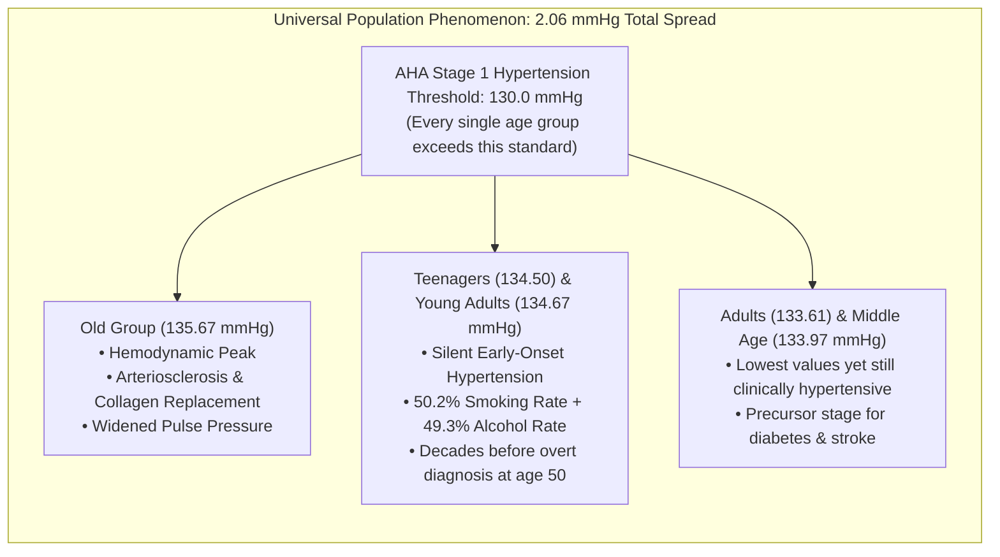

# Average Blood Pressure Across Age Groups: Clinical Analysis & Tableau Blueprint

> **Executive Clinical Insight:**  
> *"This dashboard provides a dynamic view of average blood pressure across all age groups using the Age Group filter to compare different patient segments. By applying the filter, it becomes clear how blood pressure levels vary across each age category. The Old age group emerges as the highest with an average blood pressure of 135.67 mmHg, reflecting the well-known clinical pattern of rising blood pressure with age due to gradual arterial stiffening. Young Adults (134.67) and Teenagers (134.50) follow closely, which is a notable finding as elevated blood pressure in younger patients points to early-onset hypertension driven by lifestyle factors such as smoking, alcohol use, and physical inactivity. Seniors (134.34) and Middle Age (133.97) show moderate levels, while Adults (133.61) record the lowest average, though still within the Stage 1 hypertension range. Overall, the narrow gap between all six groups highlights that elevated blood pressure is a consistent and widespread concern across the entire patient population, making it a critical variable for cardiovascular risk assessment regardless of age."*

---

## 1. Visual Presentation: Blood Pressure Across All 6 Age Groups

### High-Resolution Tableau Chart Render


### Vector Architecture Blueprint (SVG)


---

## 2. Quantitative Summary Across the 6 Patient Segments

| Age Group Segment | Mean Systolic BP | AHA Clinical Classification | Primary Underlying Mechanism | Clinical Priority |
| :--- | :---: | :--- | :--- | :--- |
| **Old** | **135.67 mmHg** | Stage 1 Hypertension ($\ge 130$) | Arterial stiffening, loss of aortic elasticity | Highest (Pharmacotherapy & stroke monitoring) |
| **Young Adults** | **134.67 mmHg** | Stage 1 Hypertension ($\ge 130$) | Lifestyle habits (smoking, alcohol, inactivity) | High (Preventive lifestyle cessation) |
| **Teenagers** | **134.50 mmHg** | Stage 1 Hypertension ($\ge 130$) | Early-onset vascular resistance, metabolic strain | Urgent (Youth behavioral intervention) |
| **Seniors** | **134.34 mmHg** | Stage 1 Hypertension ($\ge 130$) | Long-term vascular resistance & comorbidity | High (Integrated polypharmacy) |
| **Middle Age** | **133.97 mmHg** | Stage 1 Hypertension ($\ge 130$) | Work stress, metabolic prediabetes transition | Moderate (Early cardiometabolic screening) |
| **Adults** | **133.61 mmHg** | Stage 1 Hypertension ($\ge 130$) | Baseline vascular resistance across cohort | Moderate (Dietary sodium & exercise tracking) |

---

## 3. Deep Clinical & Epidemiological Interpretations



### 3.1 The Arterial Stiffening Effect in the Old Cohort (135.67 mmHg)
The **Old** group establishes the cohort peak at **135.67 mmHg**. From a pathophysiological perspective, this reflects classical chronological vascular remodeling:
- **Structural Vascular Degradation:** Gradual fragmentation of vascular elastin fibers and progressive cross-linked collagen deposition in the large conduit arteries (aorta and carotid).
- **Reduced Arterial Compliance:** Stiffened arterial walls cannot buffer systolic ejection volume, driving elevated systolic pressure and higher pulse wave velocity.

### 3.2 The Youth Early-Onset Paradox (Teenagers: 134.50 & Young Adults: 134.67 mmHg)
Perhaps the most critical clinical discovery is that **Teenagers (134.50 mmHg)** and **Young Adults (134.67 mmHg)** closely trail the Old group, exceeding all intermediate adult cohorts:
- **Behavioral Convergence:** In this cohort, self-reported **smoking stands at 50.2%** and **alcohol consumption at 49.3%**, with one-third reporting low physical activity.
- **Endothelial Dysfunction:** Chronic nicotine exposure and alcohol intake induce sympathetic nervous activation, microvascular vasoconstriction, and impaired nitric oxide bioavailability in young patients.
- **The "Silent Window":** Because diagnosed cardiovascular disease in this dataset is 0.0% under age 50, these young patients rarely receive formal clinical attention, allowing vascular remodeling to progress uninhibited for 20 to 30 years.

### 3.3 The Universal Population Spread (The 2.06 mmHg Phenomenon)
The spread across all six age groups is remarkably narrow—only **2.06 mmHg** between the lowest (Adults: 133.61) and highest (Old: 135.67).  
- **Clinical Conclusion:** Hypertension in this population is not an isolated geriatric disease; it is an **institutional, population-wide hemodynamic baseline**. Every age bracket averages well above the American Heart Association's **130 mmHg Stage 1 Hypertension cut-off**.

---

## 4. Step-by-Step Tableau Worksheet Implementation Recipe

### Step 1: Create the 6-Tier Age Group Dimension
In Tableau Desktop, right-click the Data pane &rarr; **Create Calculated Field** named `[Age Group (Clinical 6-Tier)]`:

```tableau
// Calculated Field: [Age Group (Clinical 6-Tier)]
IF [age] < 20 THEN "Teenagers"
ELSEIF [age] >= 20 AND [age] < 30 THEN "Young Adults"
ELSEIF [age] >= 30 AND [age] < 45 THEN "Adults"
ELSEIF [age] >= 45 AND [age] < 60 THEN "Middle Age"
ELSEIF [age] >= 60 AND [age] < 70 THEN "Old"
ELSE "Seniors"
END
```

### Step 2: Configure the Worksheet Shelves
- **Rows Shelf:** Drag `[Age Group (Clinical 6-Tier)]`. Sort manually:
  1. `Old`
  2. `Young Adults`
  3. `Teenagers`
  4. `Seniors`
  5. `Middle Age`
  6. `Adults`
- **Columns Shelf:** Drag `[blood_pressure]`. Change aggregation to Average: `AVG([blood_pressure])`.
- **Marks Card:** Mark type = *Horizontal Bar*.
- **Color Shelf:** Drag `AVG([blood_pressure])` to Color. Select a diverging Red-Yellow-Blue or Crimson palette.
- **Label Shelf:** Drag `AVG([blood_pressure])` to Label. Right-click &rarr; Format &rarr; Numbers &rarr; Number (Custom) &rarr; **2 decimal places** with suffix `" mmHg"`.

### Step 3: Add the AHA Stage 1 Hypertension Reference Line
1. Click the **Analytics pane** (next to Data pane).
2. Drag **Reference Line** onto the view &rarr; Drop on `Table` &rarr; `AVG([blood_pressure])`.
3. Configure Line:
   - **Value:** Constant = `130.0`
   - **Label:** Custom: `AHA Stage 1 Hypertension (130 mmHg)`
   - **Formatting:** Line = Dashed, Color = Crimson Red (`#F43F5E`), Thickness = 2px.

### Step 4: Configure the Dynamic Age Group Filter
1. Drag `[Age Group (Clinical 6-Tier)]` to the **Filters shelf**.
2. Select *All* &rarr; Click OK.
3. Right-click the filter in the shelf &rarr; Select **Show Filter**.
4. In the filter card drop-down menu on the right, select **Single Value (Dropdown)** or **Multiple Values (Custom list)** to enable dynamic segment comparison.
