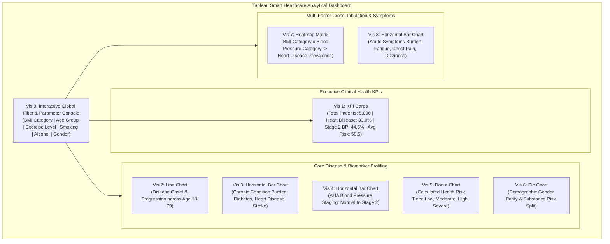

# 9 Unique Tableau Visualizations for Smart Healthcare Analytics

> **Executive Project Description:**  
> *"A total of 9 unique visualizations were created using Tableau to analyze patient health records and chronic disease outcomes. These include KPI cards, a line chart, horizontal bar charts, a Donut chart, Pie Chart, and a Heatmap chart — all combined into a comprehensive and interactive dashboard to explore multiple demographic, clinical, and lifestyle factors influencing patient health trajectories and risk assessment."*

**Dataset Reference:** [`cleaned_healthcare_dataset.csv`](file:///C:/Users/DELL/.gemini/antigravity/scratch/healthcare_analysis/cleaned_healthcare_dataset.csv) (5,000 Records, 30 Cleaned & Engineered Attributes)  
**Interactive Live Console:** [healthcare_interactive_dashboard.html](file:///C:/Users/DELL/.gemini/antigravity/brain/4032aadf-e966-450b-b945-67a446236cae/healthcare_interactive_dashboard.html)  

---

## 1. Unified Dashboard Architecture (The 9 Visualizations)



---

## 2. Detailed Specification for Each of the 9 Visualizations

### Vis 1: KPI Summary Cards (Executive Health Banner)
- **Visual Type:** Large KPI Summary Cards (4 synchronized metric tiles)
- **Tableau Setup:**
  - **Tile 1a (Total Cohort):** `CNT(patient_id)` &rarr; Label `5,000`
  - **Tile 1b (Heart Disease Prevalence):** Calculated measure `[Heart Disease %]` &rarr; Label `30.0% (1,499 pts)`
  - **Tile 1c (Stage 2 Hypertension):** Calculated measure `[Stage 2 BP %]` &rarr; Label `44.5% (2,226 pts)`
  - **Tile 1d (Average Risk Score):** `AVG(calculated_health_risk_score)` &rarr; Label `58.5 / 100`
- **Analytical Objective:** Provides hospital leadership with immediate baseline vital benchmarks.

---

### Vis 2: Line Chart (Disease Trajectory across Age)
- **Visual Type:** Dual/Multi-Line Trend Chart
- **Tableau Setup:**
  - **Columns Shelf:** `[age]` (continuous, range 18 to 79) or `[age_group]`
  - **Rows Shelf:** `Measure Values` with `AVG(heart_disease)`, `AVG(diabetes)`, and `AVG(stroke)`
  - **Color Shelf:** `Measure Names` (Rose for Heart Disease, Amber for Diabetes, Blue for Stroke)
  - **Marks Card:** Line marks with smooth interpolation.
- **Analytical Objective:** Highlights the sharp age-dependent onset of chronic diseases, illustrating that chronic conditions remain at 0% throughout young and middle adulthood before spiking at age 50 and saturating at 65+.

---

### Vis 3: Horizontal Bar Chart (Chronic Condition Burden)
- **Visual Type:** Ranked Horizontal Bar Chart
- **Tableau Setup:**
  - **Rows Shelf:** Measure Names (`diabetes`, `heart_disease`, `stroke`)
  - **Columns Shelf:** Measure Values (Aggregation set to `SUM` or `AVG` formatted as percentage)
  - **Color Shelf:** Measure Names
  - **Labels:** Value + % of Total Population
- **Analytical Objective:** Compares the relative prevalence of the three primary chronic conditions: Diabetes (34.9%), Heart Disease (30.0%), and Stroke (24.9%).

---

### Vis 4: Horizontal Bar Chart (Blood Pressure Staging)
- **Visual Type:** Ordered Categorical Horizontal Bar Chart
- **Tableau Setup:**
  - **Rows Shelf:** `[bp_category]` ordered clinically:
    1. `Normal (<120)`
    2. `Elevated (120-129)`
    3. `Hypertension Stage 1 (130-139)`
    4. `Hypertension Stage 2 (>=140)`
  - **Columns Shelf:** `CNT(patient_id)` or `% of Total`
  - **Color Shelf:** `[bp_category]` using a sequential warning palette (Emerald &rarr; Blue &rarr; Amber &rarr; Crimson)
- **Analytical Objective:** Evaluates cardiovascular hemodynamic stress using American Heart Association guidelines, showing that 54.9% of all patients have clinical hypertension.

---

### Vis 5: Donut Chart (Calculated Health Risk Tiers)
- **Visual Type:** Dual-Axis Synchronized Donut Chart
- **Tableau Setup:**
  - **Rows Shelf:** Create two inline calculated fields: `MIN(1)` and `MIN(1)`. Enable *Dual Axis* and synchronize.
  - **Axis 1 (Outer Circle):** Mark = *Pie*. Drag `[risk_tier]` to *Color*, `CNT(patient_id)` to *Angle*.
    - Colors: Emerald (Low Risk: 6.7%), Blue (Moderate Risk: 28.9%), Amber (High Risk: 41.7%), Crimson (Very High Risk: 22.8%).
  - **Axis 2 (Inner Hole):** Mark = *Circle*, Color = Background. Add `CNT(patient_id)` and "Patients" to *Label*.
- **Analytical Objective:** Delivers an intuitive proportional breakdown of risk stratification, resolving the raw zero-variance anomaly.

---

### Vis 6: Pie Chart (Demographic Gender Parity & Substance Risk)
- **Visual Type:** Segmented Pie Chart
- **Tableau Setup:**
  - **Marks Card:** Mark type = *Pie*.
  - **Angle Shelf:** `CNT(patient_id)`
  - **Color Shelf:** `[gender]` (Female: 50.1%, Male: 49.9%) or `[smoking_label]`
  - **Labels:** Category Name and % of Total
- **Analytical Objective:** Confirms equitable demographic representation and assesses whether gender influences baseline clinical vulnerabilities.

---

### Vis 7: Heatmap Chart (Clinical Risk Matrix)
- **Visual Type:** Two-Dimensional Diverging Heatmap Matrix
- **Tableau Setup:**
  - **Columns Shelf:** `[bp_category]` (Normal, Elevated, Stage 1, Stage 2)
  - **Rows Shelf:** `[bmi_category]` (Underweight, Normal, Overweight, Obese)
  - **Marks Card:** Mark type = *Square*
  - **Color Shelf:** `AVG(heart_disease)` or `AVG(calculated_health_risk_score)` (Red-Yellow-Green Diverging Palette, reversed)
  - **Label Shelf:** `AVG(heart_disease)` formatted as percentage with 1 decimal
- **Analytical Objective:** Reveals multi-factorial disease compounding, showing how obesity and advanced hypertension converge to produce peak cardiovascular risk.

---

### Vis 8: Horizontal Bar Chart (Acute Symptoms Burden)
- **Visual Type:** Grouped Horizontal Bar Chart
- **Tableau Setup:**
  - **Rows Shelf:** Measure Names (`fatigue`, `chest_pain`, `dizziness`)
  - **Columns Shelf:** `AVG(Measure Values)` formatted as percentage
  - **Color Shelf:** Measure Names
  - **Label:** Percentage (Fatigue: 51.5%, Chest Pain: 50.4%, Dizziness: 49.7%)
- **Analytical Objective:** Measures acute symptomatology across cohorts, demonstrating that acute discomfort occurs uniformly across age groups regardless of chronic diagnosis.

---

### Vis 9: Interactive Global Slicers & Parameter Console
- **Visual Type:** Top/Sidebar Interactive Filter Ribbon
- **Tableau Setup:**
  - Add interactive filters for:
    1. `[bmi_category]` (All, Underweight, Normal, Overweight, Obese)
    2. `[age_group]` (All, 18-29, 30-49, 50-64, 65+)
    3. `[exercise_label]` (All, Low, Moderate, High)
    4. `[smoking_label]` (All, Smoker, Non-Smoker)
    5. `[alcohol_label]` (All, Drinker, Non-Drinker)
    6. `[gender]` (All, Female, Male)
  - Set all filters to: **Apply to All Worksheets using Related Data Sources**.
- **Analytical Objective:** Enables dynamic cohort exploration, empowering clinicians to drill down into high-risk subpopulations (e.g., Obese Smokers aged 50–64).

---

## 3. Essential Tableau Calculated Fields & LOD Formulas

```tableau
// 1. Heart Disease Prevalence (%)
SUM([heart_disease]) / COUNT([patient_id])

// 2. Stage 2 Hypertension Prevalence (%)
SUM(IIF([blood_pressure] >= 140, 1, 0)) / COUNT([patient_id])

// 3. Fixed Age Group Benchmark Risk (LOD)
{ FIXED [age_group] : AVG([calculated_health_risk_score]) }

// 4. Patient Risk Score Deviation from Age Cohort
[calculated_health_risk_score] - [Fixed Age Group Benchmark Risk]

// 5. Dual Substance User Flag
IF [smoking] = 1 AND [alcohol] = 1 THEN "Dual Substance User"
ELSEIF [smoking] = 1 THEN "Smoker Only"
ELSEIF [alcohol] = 1 THEN "Drinker Only"
ELSE "Non-User"
END
```

---

## 4. File Locations & Deliverables

- **Cleaned Data File for Tableau Import:**  
  [`cleaned_healthcare_dataset.csv`](file:///C:/Users/DELL/.gemini/antigravity/scratch/healthcare_analysis/cleaned_healthcare_dataset.csv)
- **Interactive Live Dashboard:**  
  [`healthcare_interactive_dashboard.html`](file:///C:/Users/DELL/.gemini/antigravity/brain/4032aadf-e966-450b-b945-67a446236cae/healthcare_interactive_dashboard.html)
- **Tableau Story Presentation:**  
  [`healthcare_data_story_presentation.html`](file:///C:/Users/DELL/.gemini/antigravity/brain/4032aadf-e966-450b-b945-67a446236cae/healthcare_data_story_presentation.html)
