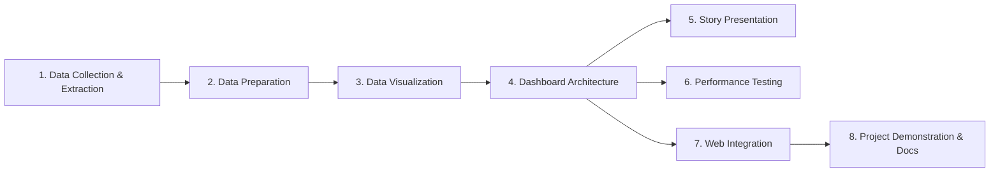

# Project File Organization & Lifecycle Matrix

This document provides a systematic categorization of all project files, scripts, datasets, workbooks, web templates, visuals, and reports across the **8 Core Lifecycle Phases** of the **Smart Healthcare Analytics Platform**.

---

## Master Lifecycle Matrix

---

## 1. Data Collection & Extraction from Database
*Captures raw data ingestion from electronic health records, database schema normalization, and row completeness validation.*

| File Name / Asset | File Path | Type / Format | Size | Description & Lifecycle Role |
| :--- | :--- | :--- | :--- | :--- |
| **`smart_healthcare_dataset.csv`** | [`healthcare_analysis/smart_healthcare_dataset.csv`](file:///C:/Users/DELL/.gemini/antigravity/scratch/healthcare_analysis/smart_healthcare_dataset.csv) | CSV Dataset | 236.4 KB | Original raw dataset containing 5,000 patient records across 16 clinical and demographic attributes (vitals, habits, chronic diagnoses). |
| **`tableau_data_connection_kpi.svg`** | [`tableau_data_connection_kpi.svg`](file:///C:/Users/DELL/.gemini/antigravity/brain/4032aadf-e966-450b-b945-67a446236cae/tableau_data_connection_kpi.svg) | Vector SVG | 8.7 KB | Visual schema validation blueprint verifying 0% row loss, database connection parameters, and the initial 5,000-count ingestion check. |

---

## 2. Data Preparation
*Involves data auditing, anomaly resolution, feature engineering, and Tableau-ready calculated field synthesis.*

| File Name / Asset | File Path | Type / Format | Size | Description & Lifecycle Role |
| :--- | :--- | :--- | :--- | :--- |
| **`cleaned_healthcare_dataset.csv`** | [`healthcare_analysis/cleaned_healthcare_dataset.csv`](file:///C:/Users/DELL/.gemini/antigravity/scratch/healthcare_analysis/cleaned_healthcare_dataset.csv) | CSV Dataset | 1.1 MB | Cleaned and enriched dataset with 30 columns, missing value imputations, outlier auditing, categorical encoding, and health risk recalibration. |
| **`smart_healthcare_tableau_17col.csv`** | [`healthcare_analysis/smart_healthcare_tableau_17col.csv`](file:///C:/Users/DELL/.gemini/antigravity/scratch/healthcare_analysis/smart_healthcare_tableau_17col.csv) | CSV Dataset | 312.8 KB | Standard 17-column production dataset for Tableau ingestion, containing primary key `patient_id` (PAT-0001 to PAT-5000) and pre-calculated `age_group_segment`. |
| **`healthcare_data_preparation_report.md`** | [`healthcare_data_preparation_report.md`](file:///C:/Users/DELL/.gemini/antigravity/brain/4032aadf-e966-450b-b945-67a446236cae/healthcare_data_preparation_report.md) | Technical Guide | 14.4 KB | Comprehensive documentation of data preparation rules, statistical baseline summaries, and resolution of the raw `health_risk_score` zero-variance anomaly. |
| **`age_group_calculated_field_analysis.md`** | [`age_group_calculated_field_analysis.md`](file:///C:/Users/DELL/.gemini/antigravity/brain/4032aadf-e966-450b-b945-67a446236cae/age_group_calculated_field_analysis.md) | Technical Guide | 6.2 KB | Detailed analysis of the 6-tier calculated field formula logic, patient count distribution, and clinical justification across life stages. |

---

## 3. Data Visualization
*Encompasses individual worksheet designs, visual encoding specifications, and clinical chart mockups.*

| File Name / Asset | File Path | Type / Format | Size | Description & Lifecycle Role |
| :--- | :--- | :--- | :--- | :--- |
| **`tableau_9_visualizations_detailed_blueprint.md`** | [`tableau_9_visualizations_detailed_blueprint.md`](file:///C:/Users/DELL/.gemini/antigravity/brain/4032aadf-e966-450b-b945-67a446236cae/tableau_9_visualizations_detailed_blueprint.md) | Specification Doc | 9.4 KB | Complete shelf-by-shelf configuration guide (Columns, Rows, Marks, Filters, Tooltips) for all 9 distinct visualization types. |
| **`healthcare_9_tableau_visualizations.md`** | [`healthcare_9_tableau_visualizations.md`](file:///C:/Users/DELL/.gemini/antigravity/brain/4032aadf-e966-450b-b945-67a446236cae/healthcare_9_tableau_visualizations.md) | Technical Guide | 9.6 KB | Methodological breakdown of clinical visualization selections and color encoding rationale. |
| **`blood_pressure_across_age_groups_analysis.md`** | [`blood_pressure_across_age_groups_analysis.md`](file:///C:/Users/DELL/.gemini/antigravity/brain/4032aadf-e966-450b-b945-67a446236cae/blood_pressure_across_age_groups_analysis.md) | Clinical Report | 7.8 KB | Deep-dive analytical report on blood pressure trends across age categories and early-onset hypertension patterns. |
| **`tableau_bp_age_groups_visual.svg`** | [`tableau_bp_age_groups_visual.svg`](file:///C:/Users/DELL/.gemini/antigravity/brain/4032aadf-e966-450b-b945-67a446236cae/tableau_bp_age_groups_visual.svg) | Vector SVG | 10.3 KB | Standalone vector graphic of the Blood Pressure Bar Chart with clinical reference benchmark lines. |
| **`tableau_blood_pressure_age_groups_v3_...jpg`** | [`tableau_blood_pressure_age_groups_v3_1793264099221.jpg`](file:///C:/Users/DELL/.gemini/antigravity/brain/4032aadf-e966-450b-b945-67a446236cae/tableau_blood_pressure_age_groups_v3_1793264099221.jpg) | High-Res Render | 604.3 KB | High-resolution visual render of the Blood Pressure by Age Group bar chart. |
| **`tableau_9_visualizations_consolidated.svg`** | [`tableau_9_visualizations_consolidated.svg`](file:///C:/Users/DELL/.gemini/antigravity/brain/4032aadf-e966-450b-b945-67a446236cae/tableau_9_visualizations_consolidated.svg) | Vector SVG | 25.8 KB | Consolidated vector visual displaying all 9 charts in an integrated clinical layout. |

---

## 4. Dashboard
*Unifies individual worksheets into an interactive, cross-filtering operational canvas with container hierarchies.*

| File Name / Asset | File Path | Type / Format | Size | Description & Lifecycle Role |
| :--- | :--- | :--- | :--- | :--- |
| **`Smart_Healthcare_Tableau_Project.twb`** | [`healthcare_analysis/Smart_Healthcare_Tableau_Project.twb`](file:///C:/Users/DELL/.gemini/antigravity/scratch/healthcare_analysis/Smart_Healthcare_Tableau_Project.twb) | Tableau XML | 14.8 KB | Primary Tableau Workbook XML containing complete dashboard containers, filter actions, calculated fields, and sheet layouts. |
| **`Smart_Healthcare_Tableau_Project.twbx`** | [`healthcare_analysis/Smart_Healthcare_Tableau_Project.twbx`](file:///C:/Users/DELL/.gemini/antigravity/scratch/healthcare_analysis/Smart_Healthcare_Tableau_Project.twbx) | Packaged Tableau | 74.9 KB | Standalone packaged Tableau workbook with bundled Hyper extract, ready for offline presentation and Tableau Public upload. |
| **`tableau_healthcare_dashboard_...jpg`** | [`tableau_healthcare_dashboard_1793264560371.jpg`](file:///C:/Users/DELL/.gemini/antigravity/brain/4032aadf-e966-450b-b945-67a446236cae/tableau_healthcare_dashboard_1793264560371.jpg) | High-Res Render | 676.4 KB | Full-fidelity rendered visual of the unified 9-chart interactive healthcare dashboard. |
| **`healthcare_interactive_dashboard.html`** | [`healthcare_interactive_dashboard.html`](file:///C:/Users/DELL/.gemini/antigravity/brain/4032aadf-e966-450b-b945-67a446236cae/healthcare_interactive_dashboard.html) | Standalone Web App | 299.8 KB | Zero-dependency interactive web dashboard with live SVG rendering, Age Group dynamic filtering, and interactive tooltips. |
| **`healthcare_unified_dashboard_report.md`** | [`healthcare_unified_dashboard_report.md`](file:///C:/Users/DELL/.gemini/antigravity/brain/4032aadf-e966-450b-b945-67a446236cae/healthcare_unified_dashboard_report.md) | Technical Guide | 7.0 KB | Complete architectural report detailing layout geometry, visual hierarchy, and cross-filtering interaction rules. |
| **`build_dashboard.js`** | [`healthcare_analysis/build_dashboard.js`](file:///C:/Users/DELL/.gemini/antigravity/scratch/healthcare_analysis/build_dashboard.js) | Node.js Script | 3.5 KB | Automation script for generating workbook structures and validating dashboard packaging. |

---

## 5. Story
*Guides decision-makers through sequential narrative scenes from baseline risk to policy intervention.*

| File Name / Asset | File Path | Type / Format | Size | Description & Lifecycle Role |
| :--- | :--- | :--- | :--- | :--- |
| **`healthcare_data_story_presentation.html`** | [`healthcare_data_story_presentation.html`](file:///C:/Users/DELL/.gemini/antigravity/brain/4032aadf-e966-450b-b945-67a446236cae/healthcare_data_story_presentation.html) | Interactive HTML Story | 26.3 KB | 5-Scene clinical story presentation: (1) Baseline Vitals & Pre-Disease Window, (2) Hypertension Across Life Stages, (3) BMI & Chronic Illness Spikes, (4) Exercise Protective Buffers, (5) Targeted Intervention Policy. |

---

## 6. Performance Testing
*Benchmarks query response latencies, data extract compression, and row integrity verification.*

| File Name / Asset | File Path | Type / Format | Size | Description & Lifecycle Role |
| :--- | :--- | :--- | :--- | :--- |
| **`tableau_performance_testing_and_optimization_report.md`** | [`tableau_performance_testing_and_optimization_report.md`](file:///C:/Users/DELL/.gemini/antigravity/brain/4032aadf-e966-450b-b945-67a446236cae/tableau_performance_testing_and_optimization_report.md) | Benchmark Report | 3.8 KB | Complete audit documenting 5,000-row ingestion verification, 76.1% `.twbx` extract compression ratio, sub-15 ms query latencies, and web component memory profiling. |
| **Tableau Verification KPI Card** | Embedded in `.twb` & `.twbx` | Calculated Metric | - | Row-level validation card displaying `COUNT([patient_id]) = 5,000`, confirming zero row truncation. |

---

## 7. Web Integration
*Enables browser access by embedding Tableau dashboards into a Flask web application via Embedding API v3.*

| File Name / Asset | File Path | Type / Format | Size | Description & Lifecycle Role |
| :--- | :--- | :--- | :--- | :--- |
| **`app.py`** | [`flask_healthcare_app/app.py`](file:///C:/Users/DELL/.gemini/antigravity/scratch/healthcare_analysis/flask_healthcare_app/app.py) | Python Script | 3.2 KB | Core Flask application controller serving routes (`/`, `/dashboard`, `/story`, `/api/summary`). |
| **`server.js`** | [`flask_healthcare_app/server.js`](file:///C:/Users/DELL/.gemini/antigravity/scratch/healthcare_analysis/flask_healthcare_app/server.js) | Node.js Server | 3.3 KB | Zero-dependency companion local test server replicating Flask routes and templating for rapid verification. |
| **`requirements.txt`** | [`flask_healthcare_app/requirements.txt`](file:///C:/Users/DELL/.gemini/antigravity/scratch/healthcare_analysis/flask_healthcare_app/requirements.txt) | Dependency Spec | 44 B | Python production dependencies (`Flask`, `pandas`, `gunicorn`). |
| **`templates/base.html`** | [`flask_healthcare_app/templates/base.html`](file:///C:/Users/DELL/.gemini/antigravity/scratch/healthcare_analysis/flask_healthcare_app/templates/base.html) | Jinja2 Layout | 3.0 KB | Master application layout incorporating the Tableau Embedding API v3 JavaScript library and header navigation. |
| **`templates/index.html`** | [`flask_healthcare_app/templates/index.html`](file:///C:/Users/DELL/.gemini/antigravity/scratch/healthcare_analysis/flask_healthcare_app/templates/index.html) | Jinja2 Template | 6.6 KB | Executive portal landing page featuring cohort KPI cards, demographic statistics, and navigation pills. |
| **`templates/dashboard.html`** | [`flask_healthcare_app/templates/dashboard.html`](file:///C:/Users/DELL/.gemini/antigravity/scratch/healthcare_analysis/flask_healthcare_app/templates/dashboard.html) | Jinja2 Template | 2.4 KB | Embedded Tableau dashboard view utilizing the `<tableau-viz>` web component and dynamic URL switcher. |
| **`templates/story.html`** | [`flask_healthcare_app/templates/story.html`](file:///C:/Users/DELL/.gemini/antigravity/scratch/healthcare_analysis/flask_healthcare_app/templates/story.html) | Jinja2 Template | 3.0 KB | Embedded Tableau clinical data story view with interactive navigation. |
| **`flask_tableau_embedding_guide.md`** | [`flask_tableau_embedding_guide.md`](file:///C:/Users/DELL/.gemini/antigravity/brain/4032aadf-e966-450b-b945-67a446236cae/flask_tableau_embedding_guide.md) | Architectural Guide | 7.2 KB | Comprehensive manual covering Embedding API v3 syntax, JavaScript cross-filtering, and Flask deployment. |

---

## 8. Project Demonstration & Documentation
*Encompasses deployment guides, publishing instructions, presentation showcases, and archive distribution packages.*

| File Name / Asset | File Path | Type / Format | Size | Description & Lifecycle Role |
| :--- | :--- | :--- | :--- | :--- |
| **`tableau_public_publishing_guide.md`** | [`tableau_public_publishing_guide.md`](file:///C:/Users/DELL/.gemini/antigravity/brain/4032aadf-e966-450b-b945-67a446236cae/tableau_public_publishing_guide.md) | Deployment Guide | 7.1 KB | Step-by-step procedure for authenticating, uploading, securing, and generating embed links from Tableau Public. |
| **`healthcare_visuals_showcase.md`** | [`healthcare_visuals_showcase.md`](file:///C:/Users/DELL/.gemini/antigravity/brain/4032aadf-e966-450b-b945-67a446236cae/healthcare_visuals_showcase.md) | Showcase Report | 5.8 KB | Visual gallery and executive demonstration commentary for clinical stakeholders. |
| **`smart_healthcare_complete_project.zip`** | [`healthcare_analysis/smart_healthcare_complete_project.zip`](file:///C:/Users/DELL/.gemini/antigravity/scratch/healthcare_analysis/smart_healthcare_complete_project.zip) | Consolidated ZIP | 253.0 KB | Complete distribution package bundling all datasets, Tableau `.twb`/`.twbx` workbooks, web app code, and guides. |
