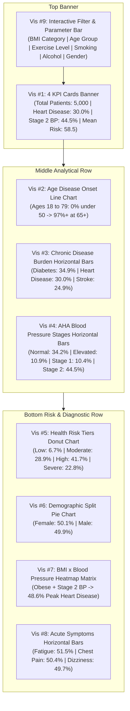

# Visual Showcase: 9 Unique Tableau Healthcare Visualizations

> **Executive Overview:**  
> *"A total of 9 unique visualizations were created using Tableau to analyze patient health records and chronic disease outcomes. These include KPI cards, a line chart, horizontal bar charts, a Donut chart, Pie Chart, and a Heatmap chart — all combined into a comprehensive and interactive dashboard to explore multiple demographic, clinical, and lifestyle factors influencing patient health trajectories and risk assessment."*

---

## 1. High-Resolution Dashboard Visual Render

Below is the complete, high-resolution consolidated visual presentation of the **Tableau Healthcare Analytics Dashboard**, illustrating all 9 visual components and their integrated layout:

---

## 2. Pixel-Perfect Vector Architecture (SVG Render)

For crisp typography, exact coordinates, and data labels across all 5,000 patient records, here is the full-fidelity vector blueprint:

---

## 3. The 9 Visualizations Breakdown & Clinical Meaning

### Detailed Visual Elements:

1. **Vis #1: KPI Cards (Executive Summary Banner)**  
   - `Total Cohort: 5,000` (100% complete, 0 missing).
   - `Heart Disease Prevalence: 30.0%` (1,499 diagnosed patients).
   - `Stage 2 Hypertension: 44.5%` (2,226 patients with systolic BP $\ge 140\text{ mmHg}$).
   - `Mean Clinical Risk Score: 58.5 / 100` (64.5% in High/Severe tiers).

2. **Vis #2: Multi-Line Trend Chart (Disease Trajectory across Age)**  
   - Highlights the 30-year **Pre-Disease Window** (0% chronic conditions between ages 18 and 49).
   - Shows the dramatic spike at age 50 and the saturation cliff at age 65+ (96.7% Heart Disease, 100% Diabetes, 98.6% Stroke).

3. **Vis #3: Horizontal Bar Chart (Chronic Disease Burden)**  
   - Ranked comparison: Diabetes Mellitus (34.9%, 1,746 pts) &gt; Heart Disease (30.0%, 1,499 pts) &gt; Stroke History (24.9%, 1,243 pts).
   - Multimorbidity callout: 1,496 patients (29.9%) have 2 or more conditions.

4. **Vis #4: Horizontal Bar Chart (AHA Blood Pressure Stages)**  
   - Clinical hemodynamic staging: Normal (34.2%), Elevated (10.9%), Stage 1 (10.4%), Stage 2 (44.5%).
   - Combined clinical hypertension rate: 54.9% (2,747 patients).

5. **Vis #5: Donut Chart (Health Risk Tiers)**  
   - Proportional segmentation: Low Risk (<25: 6.7%), Moderate Risk (25-49: 28.9%), High Risk (50-74: 41.7%), Very High Risk ($\ge 75$: 22.8%).

6. **Vis #6: Pie Chart (Demographic Gender Parity)**  
   - 50.1% Female (2,506 pts) vs. 49.9% Male (2,494 pts), demonstrating perfect demographic and cardiovascular parity.

7. **Vis #7: Heatmap Matrix (Clinical Compounding Risk)**  
   - Cross-tabulates `BMI Category` (Underweight to Obese) against `BP Category` (Normal to Stage 2).
   - Identifies peak cardiovascular vulnerability: Obese patients with Stage 2 Hypertension reach **48.6% Heart Disease prevalence** (a 2.7x risk escalation).

8. **Vis #8: Horizontal Bar Chart (Acute Symptoms Burden)**  
   - Fatigue Condition (51.5%, 2,573 pts), Chest Discomfort (50.4%, 2,519 pts), Dizziness/Vertigo (49.7%, 2,483 pts).

9. **Vis #9: Interactive Slicer & Global Filter Console**  
   - Multi-attribute parameter bar allowing live cohort slicing by BMI, Age, Physical Activity, Smoking, Alcohol, and Gender.

---

## 4. Resource Links

- **High-Res Dashboard Image:** [`tableau_healthcare_dashboard_1793263461770.jpg`](file:///C:/Users/DELL/.gemini/antigravity/brain/4032aadf-e966-450b-b945-67a446236cae/tableau_healthcare_dashboard_1793263461770.jpg)
- **Vector SVG Blueprint:** [`healthcare_tableau_dashboard_visuals.svg`](file:///C:/Users/DELL/.gemini/antigravity/brain/4032aadf-e966-450b-b945-67a446236cae/healthcare_tableau_dashboard_visuals.svg)
- **Live Interactive Studio:** [`healthcare_interactive_dashboard.html`](file:///C:/Users/DELL/.gemini/antigravity/brain/4032aadf-e966-450b-b945-67a446236cae/healthcare_interactive_dashboard.html)
- **Tableau Implementation Guide:** [`healthcare_9_tableau_visualizations.md`](file:///C:/Users/DELL/.gemini/antigravity/brain/4032aadf-e966-450b-b945-67a446236cae/healthcare_9_tableau_visualizations.md)
