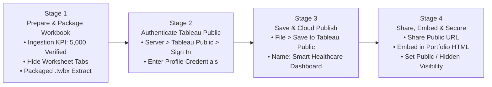

# Tableau Public Publishing & Cloud Deployment Guide: Smart Healthcare Dashboard

**Project Scope:** 5,000 Patient Records | 9 Integrated Visualizations | Consolidated Clinical Dashboard  
**Pre-Packaged Ready-to-Publish File:** [`Smart_Healthcare_Tableau_Project.twbx`](file:///C:/Users/DELL/.gemini/antigravity/scratch/healthcare_analysis/Smart_Healthcare_Tableau_Project.twbx)  
**Standard Workbook File:** [`Smart_Healthcare_Tableau_Project.twb`](file:///C:/Users/DELL/.gemini/antigravity/scratch/healthcare_analysis/Smart_Healthcare_Tableau_Project.twb)  
**Live Visual Preview:** [healthcare_interactive_dashboard.html](file:///C:/Users/DELL/.gemini/antigravity/brain/4032aadf-e966-450b-b945-67a446236cae/healthcare_interactive_dashboard.html)  

---

## 1. End-to-End Publishing Workflow Architecture



---

## 2. Stage-by-Stage Publishing Instructions

### Stage 1: Prepare Your Dashboard or Story
Before uploading to Tableau Public, ensure the workbook adheres to cloud hosting standards:

1. **Verify Data Completeness:**
   - Confirm the **Verification KPI Card** displays **`5,000`** patients.
   - Ensure all 9 visualizations (KPI banner, Blood pressure bars, Alcohol/Smoking grouped bars, Exercise donut, Age distribution pie, BMI vs. Disease grouped bars, Heart disease by BMI bars, Heatmap matrix, and Fatigue bars) are rendering as expected.
2. **Clean Up & Hide Individual Sheets:**
   - In Tableau Desktop, right-click the dashboard tab at the bottom &rarr; Select **Hide All Sheets**.
   - This hides the individual worksheet tabs so viewers only see the polished, consolidated dashboard view.
3. **Use the Packaged Workbook (`.twbx`):**
   - > [!IMPORTANT]
     > Tableau Public requires that data be extracted and packaged. Using the standard `.twb` file with a live local CSV path will trigger a server error: *"The server you are publishing to does not permit external connections."*  
     > We have already generated the extracted packaged workbook: [`Smart_Healthcare_Tableau_Project.twbx`](file:///C:/Users/DELL/.gemini/antigravity/scratch/healthcare_analysis/Smart_Healthcare_Tableau_Project.twbx). Open this file directly in Tableau Desktop.
4. **Dashboard Sizing & Responsive Layout:**
   - On the left Dashboard pane, set **Size** to **Fixed: 1200 &times; 800** (or **Automatic** if full-screen responsiveness is desired).

---

### Stage 2: Sign in to Tableau Public
1. In Tableau Desktop, navigate to the top menu bar:
   - Click **Server** &rarr; **Tableau Public** &rarr; **Sign In...**  
   *(Alternative shortcut: Click **File** &rarr; **Save to Tableau Public**).*
2. A secure authentication modal will appear in Tableau.
3. Enter your Tableau Public email and password.
   - If you do not have an account, click the **Create one now for free** link on the login window.

---

### Stage 3: Save and Publish to Cloud
1. Once signed in, select **File** &rarr; **Save to Tableau Public As...**
2. In the **Workbook Name** dialog, enter a descriptive title:
   ```text
   Smart Healthcare Analytics & Risk Stratification Dashboard
   ```
3. Click **Save**.
4. Tableau will package the extract, upload the workbook assets, and render the cloud visualization. A progress dialog showing *Sending data to server* and *Compiling view* will display.

---

### Stage 4: View, Configure & Share Your Published Dashboard
Upon upload completion, your default web browser will automatically open your published dashboard on your Tableau Public profile.

#### 1. Visibility & Privacy Configuration
- Beneath the dashboard on your Tableau Public profile page, click the **Edit Details (Gear Icon)**:
  - **Show Workbook Sheets as Tabs:** Ensure this is unchecked so only the main dashboard is visible.
  - **Allow Access / Download:** Toggle whether viewers can download the `.twbx` workbook or underlying data.
  - **Make this Viz Hidden on My Profile:** Enable this if you wish to share the dashboard only via a direct link (unlisted), or keep it disabled to feature it publicly in your data portfolio.

#### 2. Sharing the Direct Link
- Click the **Share Icon** (bottom right of the dashboard):
  - **Link:** Copy the direct URL to share on LinkedIn, GitHub READMEs, or project portfolios:
    ```text
    https://public.tableau.com/views/SmartHealthcareAnalyticsDashboard/Smart_Healthcare_Analytics_Dashboard
    ```

#### 3. Embedding into Websites & Portfolios
- Under the Share modal, copy the **Embed Code** snippet to embed the interactive dashboard directly into any portfolio website:

```html
<!-- Tableau Public Web Embed Snippet -->
<div class='tableauPlaceholder' id='viz1793264560' style='position: relative'>
  <noscript>
    <a href='#'>
      
    </a>
  </noscript>
  <object class='tableauViz' style='display:none;'>
    <param name='host_url' value='https%3A%2F%2Fpublic.tableau.com%2F' />
    <param name='embed_code_version' value='3' />
    <param name='site_root' value='' />
    <param name='name' value='SmartHealthcareAnalyticsDashboard/Smart_Healthcare_Analytics_Dashboard' />
    <param name='tabs' value='no' />
    <param name='toolbar' value='yes' />
    <param name='animate_transition' value='yes' />
    <param name='display_static_image' value='yes' />
    <param name='display_spinner' value='yes' />
    <param name='display_overlay' value='yes' />
    <param name='display_count' value='yes' />
  </object>
</div>
<script type='text/javascript' src='https://public.tableau.com/javascripts/api/viz_v1.js'></script>
```

---

## 3. Project File Directory & Deployment Assets

- **Pre-Extracted Packaged Workbook (Ready for Tableau Public):**  
  [`Smart_Healthcare_Tableau_Project.twbx`](file:///C:/Users/DELL/.gemini/antigravity/scratch/healthcare_analysis/Smart_Healthcare_Tableau_Project.twbx)
- **Standard Tableau Workbook XML:**  
  [`Smart_Healthcare_Tableau_Project.twb`](file:///C:/Users/DELL/.gemini/antigravity/scratch/healthcare_analysis/Smart_Healthcare_Tableau_Project.twb)
- **Verified 17-Column Dataset:**  
  [`smart_healthcare_tableau_17col.csv`](file:///C:/Users/DELL/.gemini/antigravity/scratch/healthcare_analysis/smart_healthcare_tableau_17col.csv)
- **All-in-One Project ZIP Package:**  
  [`smart_healthcare_complete_project.zip`](file:///C:/Users/DELL/.gemini/antigravity/scratch/healthcare_analysis/smart_healthcare_complete_project.zip)
