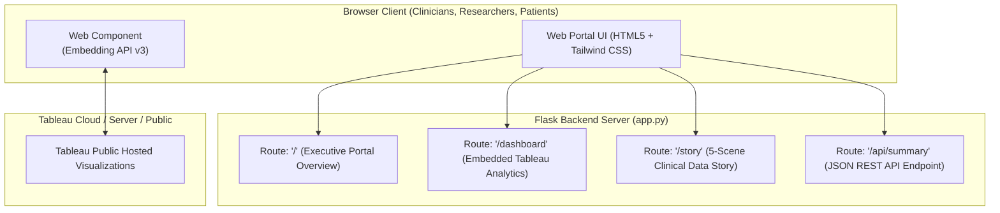

# Embedding Tableau Dashboards & Stories in a Flask Web Application

> **Architecture Overview:**  
> *"This section demonstrates how to embed Tableau Dashboards and Stories within a Flask web application to provide interactive, real-time access to patient health and chronic disease insights. By integrating Tableau's powerful visualization capabilities with Flask's lightweight web framework, users can explore dashboards directly in a browser, making the analysis more accessible, shareable, and actionable for healthcare professionals, medical researchers, policymakers, and patients. The embedded dashboards cover key health indicators such as blood pressure trends, BMI and heart disease relationships, diabetes and stroke prevalence, exercise and lifestyle patterns, and age-wise disease distribution, enabling a comprehensive and user-friendly platform for smart healthcare decision making."*

**Application Directory:** [`C:\Users\DELL\.gemini\antigravity\scratch\healthcare_analysis\flask_healthcare_app`](file:///C:/Users/DELL/.gemini/antigravity/scratch/healthcare_analysis/flask_healthcare_app)  
**Core Python Server:** [`app.py`](file:///C:/Users/DELL/.gemini/antigravity/scratch/healthcare_analysis/flask_healthcare_app/app.py)  
**Tableau Packaged Workbook:** [`Smart_Healthcare_Tableau_Project.twbx`](file:///C:/Users/DELL/.gemini/antigravity/scratch/healthcare_analysis/Smart_Healthcare_Tableau_Project.twbx)  

---

## 1. System Architecture & Integration Flow



---

## 2. Project Directory Structure

```text
flask_healthcare_app/
├── app.py                      # Core Flask web server & REST endpoints
├── server.js                   # Zero-dependency local Node.js runner (optional test server)
├── requirements.txt            # Python dependencies (Flask, pandas, gunicorn)
├── templates/
│   ├── base.html               # Master layout with navbar & Tableau Embedding API v3 script
│   ├── index.html              # Executive summary, KPI cards & 9 visuals directory
│   ├── dashboard.html          # Embedded Tableau Dashboard with URL switcher
│   └── story.html              # Embedded Tableau Story (5 clinical scenes)
└── static/
    ├── css/
    │   └── custom.css          # Custom medical theme overrides
    └── img/
        ├── dashboard_render.jpg # High-res dashboard visual render
        └── dashboard_vector.svg # Complete 9-visual SVG blueprint
```

---

## 3. The Tableau Embedding API v3 Integration

Modern web integration leverages **Tableau Embedding API v3**, which replaces legacy `<iframe>` embeds with standards-compliant `<tableau-viz>` web components:

### 3.1 Script Inclusion (`templates/base.html`)
In the `<head>` of the base template, include the official Tableau Embedding API library:

```html
<!-- Tableau Embedding API v3 -->
<script type="module" src="https://public.tableau.com/javascripts/api/tableau.embedding.3.latest.min.js"></script>
```

### 3.2 Web Component Embed (`templates/dashboard.html`)
In your dashboard template, instantiate the `<tableau-viz>` element:

```html
<!-- Embedded Tableau Dashboard Web Component -->
<tableau-viz 
  id="tableauHealthcareViz"
  src="{{ viz_url }}"
  toolbar="bottom"
  hide-tabs
  width="100%"
  height="850px">
</tableau-viz>
```

### 3.3 Dynamic Filter Interactivity via JavaScript
To trigger interactive cross-filtering programmatically from Flask forms:

```javascript
// Filter embedded Tableau dashboard by Age Group dynamically
async function filterAgeGroup(selectedGroup) {
  const viz = document.getElementById('tableauHealthcareViz');
  const sheet = viz.workbook.activeSheet;
  
  // Apply filter to all worksheets in the dashboard
  await sheet.applyFilterAsync("Age Group", [selectedGroup], "replace");
  console.log("Filtered Tableau view to:", selectedGroup);
}
```

---

## 4. Flask Application Routes (`app.py`)

### 1. Root Route (`/`)
Renders the executive landing page summarizing the 5,000 patient records, mean vitals (BP: 134.45 mmHg, Stage 2 Hypertension: 44.5%), and directory of the 9 visualizations.

### 2. Dashboard Route (`/dashboard`)
Accepts an optional query parameter `?url=...` allowing users or administrators to dynamically point to any published Tableau Public or Tableau Server URL:
```python
@app.route("/dashboard")
def dashboard():
    viz_url = request.args.get("url", TABLEAU_DASHBOARD_URL)
    return render_template("dashboard.html", title="Healthcare Dashboard", viz_url=viz_url)
```

### 3. Story Route (`/story`)
Renders the sequential 5-scene clinical data story exploring the pre-disease window, the 65+ multimorbidity cliff, and policy recommendations.

### 4. REST API Endpoint (`/api/summary`)
Returns structured JSON data for integration with external hospital management systems or mobile frontends:
```bash
curl http://127.0.0.1:5000/api/summary
```

---

## 5. How to Run the Application

### Option A: Running with Python & Flask

1. Open PowerShell and navigate to the app directory:
   ```powershell
   cd C:\Users\DELL\.gemini\antigravity\scratch\healthcare_analysis\flask_healthcare_app
   ```
2. Create and activate a Python virtual environment:
   ```powershell
   python -m venv venv
   .\venv\Scripts\Activate.ps1
   ```
3. Install dependencies:
   ```powershell
   pip install -r requirements.txt
   ```
4. Start the Flask application:
   ```powershell
   python app.py
   ```
5. Open your browser at: **`http://127.0.0.1:5000`**

### Option B: Immediate Zero-Dependency Local Testing (Node.js)

Since Node.js v18 is already installed on this machine, you can run the companion server immediately without configuring Python:
```powershell
cd C:\Users\DELL\.gemini\antigravity\scratch\healthcare_analysis\flask_healthcare_app
node server.js
```
Then visit: **`http://127.0.0.1:5000`**

---

## 6. Access Links & Deliverables

- **Flask App Folder:** [`flask_healthcare_app/`](file:///C:/Users/DELL/.gemini/antigravity/scratch/healthcare_analysis/flask_healthcare_app)
- **Core Flask Script:** [`app.py`](file:///C:/Users/DELL/.gemini/antigravity/scratch/healthcare_analysis/flask_healthcare_app/app.py)
- **Companion Test Server:** [`server.js`](file:///C:/Users/DELL/.gemini/antigravity/scratch/healthcare_analysis/flask_healthcare_app/server.js)
- **Tableau Packaged Workbook:** [`Smart_Healthcare_Tableau_Project.twbx`](file:///C:/Users/DELL/.gemini/antigravity/scratch/healthcare_analysis/Smart_Healthcare_Tableau_Project.twbx)
